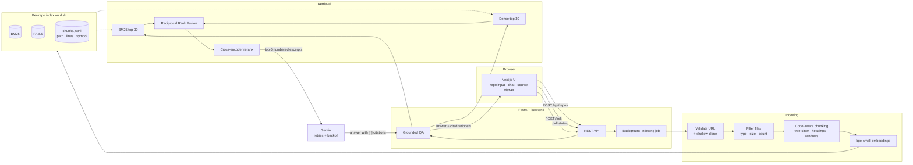

# RepoRAG

[](https://github.com/bhavishyabondalapati/RepoRAG/actions/workflows/ci.yml)

**Ask questions about any public GitHub repo and get answers that cite the exact files and lines.**

RepoRAG clones a public GitHub repository, splits the code and docs into function- and section-sized chunks, and indexes them for hybrid search (keyword + semantic). When you ask a question, it retrieves the most relevant chunks, has an LLM answer **only** from them, and cites every claim with a file path and line range you can click to inspect. If the repo doesn't contain the answer, it says *"not enough information in this repo"* instead of guessing.

> **Demo GIF:** TODO. Record the app (index a repo → ask → click a citation) and save it as `docs/demo.gif`, then replace this line with ``.

---

## Contents

- [Architecture](#architecture)
- [How retrieval works](#how-retrieval-works)
- [Evaluation](#evaluation)
- [Quickstart](#quickstart)
- [Environment variables](#environment-variables)
- [Running the tests](#running-the-tests)
- [Project structure](#project-structure)
- [Tools and libraries](#tools-and-libraries)
- [Design decisions and tradeoffs](#design-decisions-and-tradeoffs)
- [How it was built](#how-it-was-built)
- [Key concepts](#key-concepts)
- [Limitations](#limitations)
- [Future work](#future-work)
- [License](#license)

## Architecture



## How retrieval works

1. **Chunking.** Python, JavaScript and TypeScript files are parsed with **tree-sitter** and split at function and class boundaries, so a chunk is a complete unit of meaning. Classes over 120 lines are split into their methods. Markdown is split by headings, and other files fall back to 60-line windows with 10 lines of overlap. Each chunk keeps its **file path, language, symbol name, and start/end lines**.
2. **Two retrievers.** **BM25** catches exact identifiers (`unsign`, `max_age`). The tokenizer also splits `camelCase` and `snake_case`, so "get user" matches `getUser`. **Dense search** (`bge-small-en-v1.5` + FAISS) catches meaning when the wording differs.
3. **Fusion.** **Reciprocal Rank Fusion** merges the two ranked lists with `score = Σ 1/(60 + rank)`. It uses ranks, not raw scores, so BM25 scores and cosine similarities never need to be on the same scale.
4. **Reranking.** A **cross-encoder** (`ms-marco-MiniLM-L-6-v2`) reads the question and each of the top 30 candidates together and re-scores them. The top 6 go to the LLM.
5. **Grounded generation.** The LLM sees numbered excerpts and must cite them as `[n]`. Three guards produce "not enough information in this repo":
   - the reranker's best score is below a threshold, so the LLM isn't called at all
   - the LLM itself says the context is insufficient
   - the answer contains no valid citations

## Evaluation

The eval set has **32 hand-written questions** over two well-known repos, each pinned to a commit: [`pallets/itsdangerous`](https://github.com/pallets/itsdangerous) (Python) and [`sindresorhus/ky`](https://github.com/sindresorhus/ky) (TypeScript). 28 questions have hand-labelled gold evidence (file + line range), and 4 are deliberately unanswerable. See [`eval/datasets/`](eval/datasets).

A separate **held-out set of 20 questions** (18 answerable, 2 unanswerable) lives in [`eval/datasets/heldout/`](eval/datasets/heldout). It covers parts of the same repos that the first 32 never ask about, and it was written *before* any retrieval tuning. The 32 questions are the development set: I studied their failures, so future changes may be tuned against them. Held-out numbers are only for reporting (`python eval/run_eval.py --split heldout`).

- **Recall@5:** fraction of gold evidence spans that appear in the top 5 retrieved chunks
- **MRR@10:** mean of 1 / rank of the first relevant chunk
- **Faithfulness:** an LLM judge splits each answer into claims and checks each against the retrieved context
- **Answer rate / Abstention:** answerable questions that got an answer, and unanswerable questions that were correctly refused
- **Citation precision / recall:** of the chunks an answer cites, the share that overlap the gold evidence (precision), and the share of gold evidence spans the citations cover (recall). Deterministic, no extra LLM calls

Results from a real run (`python eval/run_eval.py --no-llm`, Apple M4 Pro, MPS):

| Retrieval mode | Recall@5 | MRR@10 | Retrieval latency |
|---|---|---|---|
| BM25 only | 0.589 | 0.486 | 1 ms |
| Dense only | 0.518 | 0.335 | 14 ms |
| Hybrid (RRF) | 0.589 | 0.446 | 8 ms |
| Hybrid + rerank | 0.589 | 0.385 | 110 ms |

Per repository (Recall@5 / MRR@10):

| Retrieval mode | itsdangerous | ky |
|---|---|---|
| BM25 only | 0.821 / 0.722 | 0.357 / 0.250 |
| Dense only | 0.821 / 0.542 | 0.214 / 0.129 |
| Hybrid (RRF) | 0.964 / 0.723 | 0.214 / 0.169 |
| Hybrid + rerank | 0.893 / 0.621 | 0.286 / 0.149 |

**Held-out baseline (before any retrieval tuning).** These are the 20 held-out questions, scored retrieval-only on the current pipeline (`python eval/run_eval.py --split heldout --no-llm`, run 2026-11-01). Future retrieval changes will be compared against these numbers.

| Retrieval mode | Recall@5 | MRR@10 | itsdangerous (R@5 / MRR) | ky (R@5 / MRR) |
|---|---|---|---|---|
| BM25 only | 0.722 | 0.687 | 1.000 / 0.911 | 0.444 / 0.463 |
| Dense only | 0.667 | 0.631 | 1.000 / 0.917 | 0.333 / 0.344 |
| Hybrid (RRF) | 0.722 | 0.667 | 1.000 / 0.944 | 0.444 / 0.389 |
| Hybrid + rerank | 0.667 | 0.639 | 1.000 / 0.944 | 0.333 / 0.333 |

The pattern matches the dev set: itsdangerous is easy for every mode, ky is hard, and the reranker doesn't help on ky.

> **Not measured yet:** faithfulness, answer rate, abstention, and citation precision/recall. The eval code for all five is written and unit-tested, but it needs about 100 Gemini calls (answers plus judge calls) and the free tier allows 20 per day per model, so I have not run it. The retrieval metrics above are the measured results; none of the LLM numbers are estimated. To measure them: `python eval/run_eval.py --llm-modes hybrid_rerank --rpm 4` (responses are cached, so it can resume across days).

**What the numbers say:**

- **Hybrid wins on a small, clean repo.** On itsdangerous, fusing BM25 and dense search raised recall@5 from 0.82 to 0.96. Each retriever found evidence the other missed.
- **Keyword search is a strong baseline for code.** Questions about code tend to contain identifiers, and BM25 matches those exactly. Dense search alone was weakest everywhere.
- **The off-the-shelf reranker hurt ranking.** `ms-marco-MiniLM` was trained on web search passages, not code. It lowered MRR versus plain hybrid (0.446 → 0.385). This is a domain-mismatch result worth knowing before adding "rerank" to a pipeline by default.
- **ky is hard.** Its test files are thousands of lines long and full of the words the questions use ("retry", "timeout"), so test chunks crowd out the 10-line source function that actually answers the question. See [Limitations](#limitations).

## Quickstart

### Option A: Docker Compose

```bash
git clone https://github.com/bhavishyabondalapati/RepoRAG.git
cd RepoRAG
cp .env.example .env        # then put your GEMINI_API_KEY in .env
docker compose up --build
```

Open http://localhost:3000. The first indexing run downloads the embedding and reranker models (~200 MB) into a Docker volume, so later runs are fast.

### Option B: Run locally (conda)

**1. Create the environment and install packages**

```bash
git clone https://github.com/bhavishyabondalapati/RepoRAG.git
cd RepoRAG
conda create -n RepoRAG python=3.11 -y
conda activate RepoRAG
pip install -r requirements.txt     # backend deps + dev tools + the backend package
cp .env.example .env                # then put your GEMINI_API_KEY in .env
```

**2. Start the backend** (terminal 1)

```bash
uvicorn reporag.main:app --app-dir backend --port 8000
```

**3. Start the frontend** (terminal 2, Node.js 22+)

```bash
cd frontend
npm install
npm run dev
```

Open http://localhost:3000 and try `https://github.com/pallets/itsdangerous`. On Apple Silicon the models run on the GPU through PyTorch's `mps` backend automatically.

**4. Run the evaluation**

```bash
python eval/run_eval.py --no-llm   # retrieval metrics only, no API key needed
python eval/run_eval.py            # adds LLM answers + faithfulness judge (needs GEMINI_API_KEY)
```

Results are written to `eval/results/results.md` and `eval/results/results.json`.

## Environment variables

| Variable | Default | Purpose |
|---|---|---|
| `GEMINI_API_KEY` | none | Required to answer questions and for the faithfulness eval |
| `GEMINI_MODEL` | `gemini-3.8-flash` | Gemini model id |
| `GITHUB_TOKEN` | none | Optional; raises the GitHub API rate limit for repo-size checks |
| `REPORAG_DATA_DIR` | `./data` | Where clones and indexes are stored |
| `REPORAG_MAX_REPO_MB` | `50` | Reject repositories larger than this |
| `REPORAG_MAX_FILES` | `2000` | Maximum files indexed per repo |
| `REPORAG_MAX_FILE_KB` | `200` | Skip files larger than this |
| `REPORAG_DEVICE` | `auto` | `auto` picks `mps` → `cuda` → `cpu` |
| `NEXT_PUBLIC_API_URL` | `http://localhost:8000` | Backend URL used by the browser |

Only `.env.example` (placeholders) is committed. `.env` is git-ignored.

## Running the tests

```bash
python -m pytest backend/tests eval/test_metrics.py   # 73 tests, ~1 second, no network or models
ruff check . && ruff format --check .                  # lint + formatting
cd frontend && npm run lint && npx tsc --noEmit         # frontend lint + types
```

Tests use small fake embedders, rerankers and LLMs (`backend/tests/fakes.py`), so they run offline in about a second. GitHub Actions runs all of the above on every push.

## Project structure

```
.
├── .env.example                  Placeholder environment variables (copy to .env)
├── .gitignore                    Ignores secrets, indexes, cloned repos, node_modules, caches
├── .github/workflows/ci.yml      CI: ruff + pytest for backend, lint + typecheck + build for frontend
├── LICENSE                       MIT license
├── README.md                     This file
├── docker-compose.yml            Runs backend + frontend with persistent data/model volumes
├── requirements.txt              One-shot local install: backend deps, dev tools, backend package
├── ruff.toml                     Shared lint/format config for backend and eval
├── docs/
│   └── DESIGN.md                 Plain-language explanation of every major design decision
├── backend/
│   ├── Dockerfile                CPU-only Python image that serves the API with uvicorn
│   ├── .dockerignore             Keeps tests, caches and data out of the image
│   ├── pyproject.toml            Package metadata and pytest config
│   ├── requirements.txt          Runtime dependencies
│   ├── requirements-dev.txt      Adds pytest and ruff
│   ├── reporag/
│   │   ├── __init__.py           Package marker
│   │   ├── config.py             Settings from env, indexable file types, device selection
│   │   ├── main.py               FastAPI app and routes (index, status, ask, health)
│   │   ├── schemas.py            Pydantic request/response models
│   │   ├── jobs.py               Background indexing jobs + in-memory index cache
│   │   ├── indexer.py            End-to-end pipeline: clone → chunk → embed → save
│   │   ├── index_store.py        Build, save and load a repo index (chunks, BM25, FAISS)
│   │   ├── qa.py                 Prompting, citation parsing, "not enough information" guards
│   │   ├── ingest/
│   │   │   ├── __init__.py       Package marker
│   │   │   ├── github.py         GitHub URL validation, size check, shallow clone, file filtering
│   │   │   └── chunking.py       tree-sitter code chunking, markdown heading splits, line windows
│   │   ├── retrieval/
│   │   │   ├── __init__.py       Package marker
│   │   │   ├── bm25.py           Code-aware tokenizer + BM25 keyword index
│   │   │   ├── dense.py          Sentence-transformer embeddings + FAISS index
│   │   │   ├── fusion.py         Reciprocal Rank Fusion
│   │   │   ├── rerank.py         Cross-encoder reranker
│   │   │   └── pipeline.py       Retriever with four modes: bm25, dense, hybrid, hybrid_rerank
│   │   └── llm/
│   │       ├── __init__.py       Package marker
│   │       ├── base.py           Provider-agnostic LLM interface + factory
│   │       ├── gemini.py         Gemini provider with retryable-error classification
│   │       └── retry.py          Exponential backoff with jitter
│   └── tests/
│       ├── __init__.py           Package marker
│       ├── fakes.py              Fake embedder, reranker and LLM for fast offline tests
│       ├── test_api.py           API endpoints end to end with fakes
│       ├── test_chunking.py      Function/class splits, line numbers, markdown, windows
│       ├── test_github.py        URL validation (incl. malicious inputs) and file filtering
│       ├── test_llm.py           Retry/backoff behavior and Gemini error classification
│       ├── test_qa.py            Citation parsing and refusal guards
│       └── test_retrieval.py     RRF math, BM25 tokenizer, all retrieval modes, index round trip
├── eval/
│   ├── datasets/
│   │   ├── repos.json            Eval repos and the exact commits they are pinned to
│   │   ├── itsdangerous.jsonl    16 questions with gold file/line evidence (Python repo)
│   │   ├── ky.jsonl              16 questions with gold file/line evidence (TypeScript repo)
│   │   └── heldout/
│   │       ├── itsdangerous.jsonl  10 held-out questions, written before any tuning
│   │       └── ky.jsonl            10 held-out questions, written before any tuning
│   ├── metrics.py                Recall@k, MRR, LLM-judge prompt and score parsing
│   ├── run_eval.py               Runs all four retrieval modes and writes the results table
│   ├── test_metrics.py           Unit tests for the metrics
│   └── results/
│       ├── results.md            Latest results table (copied into this README)
│       ├── results.json          Full results including per-question top-5 chunks
│       └── heldout/
│           ├── results.md        Held-out baseline table (retrieval only, before tuning)
│           └── results.json      Full held-out baseline results
└── frontend/
    ├── Dockerfile                Multi-stage build to a small standalone Next.js server
    ├── .dockerignore             Keeps node_modules and build output out of the image
    ├── .gitignore                Next.js ignores
    ├── README.md                 Frontend-specific notes
    ├── eslint.config.mjs         ESLint config (Next.js rules)
    ├── next.config.ts            Standalone output for Docker
    ├── package.json              Frontend dependencies and scripts
    ├── package-lock.json         Locked dependency versions
    ├── tsconfig.json             TypeScript config
    └── src/
        ├── app/
        │   ├── favicon.ico       Browser tab icon
        │   ├── globals.css       Color tokens (light + dark), base typography
        │   ├── layout.tsx        Root layout and fonts (IBM Plex Sans / Mono)
        │   └── page.tsx          Renders the workbench
        ├── components/
        │   ├── Workbench.tsx     Page state: repo input, progress polling, chat turns, mode picker
        │   ├── Workbench.module.css  All component styles
        │   ├── AnswerBody.tsx    Markdown answer with clickable [n] citation chips
        │   ├── IndexProgress.tsx Clone → chunk → embed → ready progress
        │   └── SourcePanel.tsx   Cited snippet with real line numbers and GitHub link
        └── lib/
            └── api.ts            Typed fetch client for the backend
```

## Tools and libraries

| Tool | Why it was chosen |
|---|---|
| **FastAPI + Pydantic** | Typed request validation and auto-generated API docs (`/docs`) with very little code |
| **tree-sitter** | Real parsers for many languages; gives exact function/class boundaries and line numbers instead of guessing with regex |
| **rank_bm25** | Simple, dependency-light BM25 for exact keyword/identifier matching |
| **sentence-transformers + bge-small-en-v1.5** | Small (33M params, 384-dim) and strong on retrieval benchmarks; fast enough to embed a repo on a laptop |
| **FAISS** | Industry-standard vector search; an exact flat index is plenty for one repo's few thousand chunks |
| **Cross-encoder ms-marco-MiniLM-L-6-v2** | Small, fast reranker; included to measure whether reranking helps on code (it didn't, see eval) |
| **Gemini (google-genai)** | Fast and inexpensive, with a generous free tier; behind an interface so other providers can be added |
| **Next.js + TypeScript** | Typed React with a production build and a standalone server output for Docker |
| **react-markdown** | Safe Markdown rendering that lets us swap `[n]` links for citation buttons |
| **pytest + ruff** | Fast tests and one tool for linting and formatting |
| **Docker Compose + GitHub Actions** | One-command local run and automatic checks on every push |

## Design decisions and tradeoffs

The short version is below. [`docs/DESIGN.md`](docs/DESIGN.md) explains each decision in plain language.

- **Code-aware chunks over fixed windows.** A whole function is a better retrieval unit than an arbitrary 60 lines. Citations line up with real code boundaries too. *Tradeoff:* it needs a grammar per language, so other languages fall back to windows.
- **Hybrid search over pure vector search.** Code questions name identifiers, and dense embeddings blur exact tokens. The eval confirms BM25 is the stronger single retriever on code. *Tradeoff:* two indexes to build and keep in sync.
- **RRF over score blending.** No tuning of weights or normalization between incompatible score scales. *Tradeoff:* it ignores how confident each retriever is.
- **Refuse rather than guess.** Three independent guards plus mandatory citations. *Tradeoff:* sometimes refuses questions it could have answered (measured as "answer rate").
- **Flat FAISS index, files on disk.** Exact search, no database to run, indexes survive restarts. *Tradeoff:* not designed for thousands of repos or multi-node serving.
- **One indexing worker and an inference lock.** Embedding is GPU- and memory-heavy, and MPS isn't safe to drive from several threads. *Tradeoff:* concurrent index requests queue.
- **Provider-agnostic LLM interface.** One `generate()` method, so swapping Gemini for another model is a single class. Retries only on 408/429/5xx and network errors, never on bad requests.
- **Strict URL validation.** Only `https://github.com/<owner>/<repo>` passes. That blocks other hosts, credentials in URLs, deep links, and shell metacharacters before anything reaches `git`.

## How it was built

1. Set up the repo, a commit-message hook, `.gitignore`, license, and an `.env.example` with placeholders only.
2. Wrote GitHub URL validation, a size check through the GitHub API, shallow cloning, and file filtering (type, size, count, skipped dirs).
3. Built the chunker: tree-sitter for Python/JS/TS, heading splits for Markdown, windows for everything else. Tests check that every chunk's text matches its line numbers exactly.
4. Added BM25 with a code-aware tokenizer, dense search with FAISS, RRF fusion, and the cross-encoder reranker behind one `Retriever` with four modes.
5. Added the provider-agnostic LLM interface and the Gemini provider with exponential backoff and jitter.
6. Wrote grounded QA (numbered excerpts, citation parsing, three refusal guards), background indexing jobs, and the FastAPI routes, with API tests that use fake models.
7. Indexed the two eval repos with the real models to check the pipeline end to end.
8. Read both eval repos and hand-wrote 32 questions with gold file/line spans, then verified every span with a script.
9. Wrote the eval runner (recall@5, MRR@10, LLM-judge faithfulness, abstention) and recorded the real retrieval results.
10. Built the Next.js frontend and checked it in a browser (desktop, phone width, light and dark).
11. Added Dockerfiles, docker-compose, and GitHub Actions CI.
12. Wrote this README and `docs/DESIGN.md`.

## Key concepts

What to understand (and be able to explain in an interview):

- **RAG (Retrieval-Augmented Generation):** instead of trusting what the model memorized, retrieve relevant text and make the model answer from it. That makes answers checkable and current.
- **Chunking matters:** retrieval can only return what you indexed. Chunks that follow code structure keep a function's logic together.
- **Sparse vs dense retrieval:** BM25 scores exact word overlap (great for identifiers). Embeddings score meaning (great for paraphrases). They fail in different places, which is why combining them helps.
- **Reciprocal Rank Fusion:** combines ranked lists using only positions, `1/(k + rank)`, so you never compare incompatible scores.
- **Bi-encoder vs cross-encoder:** a bi-encoder embeds the query and documents separately (fast, can be precomputed). A cross-encoder reads them together (more accurate, but too slow for the whole corpus, so it only reranks the top candidates).
- **Domain shift:** a model trained on web passages (MS MARCO) can make code retrieval worse. Always measure before assuming a component helps.
- **Evaluation metrics:** recall@k ("did we find the evidence?"), MRR ("how high was it?"), faithfulness ("did the answer stick to the evidence?"). An LLM judge is convenient but is itself a model with biases.
- **Hallucination control:** grounding, mandatory citations, and explicit refusal paths. A system that can say "I don't know" is more trustworthy.
- **Exponential backoff with jitter:** retry transient failures with growing waits, randomized so many clients don't retry in lockstep.
- **Input validation as security:** a URL that ends up in a `git` command must be strictly validated first.

## Limitations

- **Large test suites drown out source code.** In ky, giant test files share the vocabulary of most questions and outrank the short source functions that actually answer them (ky recall@5 tops out at 0.36).
- **The reranker is not trained on code.** It lowers ranking quality versus plain hybrid search on this eval.
- **Only Python, JavaScript and TypeScript get structural chunking.** Other languages use line windows.
- **Long chunks are truncated by the models.** Both models read at most 512 tokens, so the end of a 120-line chunk is invisible to them.
- **Indexes are cached by repo name.** Use "re-index" to pick up new commits.
- **The eval set is small** (32 questions, 2 repos). Numbers show direction, not statistical certainty. Faithfulness comes from an LLM judge, not human review.
- **Single-process server.** Jobs and the index cache live in memory, which suits a local tool, not a multi-user deployment.
- **The refusal threshold (`min_rerank_score = -6`) was picked by hand,** not tuned on held-out data.

## Future work

- Down-weight or separately index test files, and boost source files for "how is X implemented" questions.
- Try a code-trained reranker or embedding model (or fine-tune on code Q&A) and compare it on this eval.
- Add tree-sitter grammars for Go, Rust and Java.
- Stream answers token by token, and add multi-turn conversation memory.
- Index by commit SHA, with incremental re-indexing of changed files.
- Grow the eval set (the held-out split already exists; tune the refusal threshold on a separate validation split), and add human-graded faithfulness.
- Add more LLM providers behind the existing interface.

## License

[MIT](LICENSE) © 2026 Bhavishya Bondalapati
